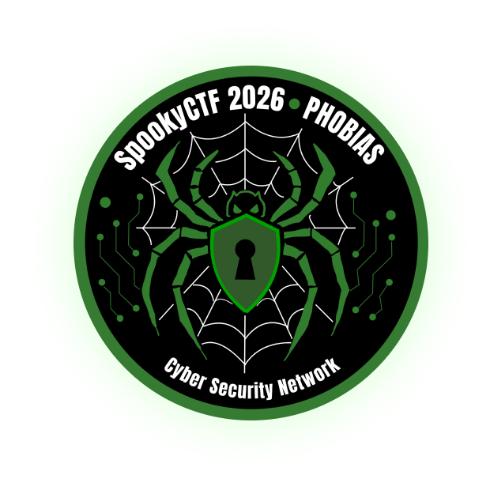
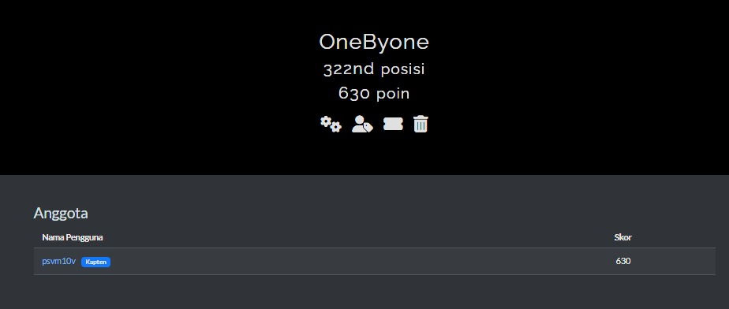

<h1 align="center">👻 SpookyCTF 2026</h1>

  

<h3 align="center">Team OneByOne</h3>

  <b>Capture The Flag Write-ups & Solutions</b>

  

---

## 🏆 Team Achievement

| Detail | Information |
|---|---|
| Team | OneByOne |
| Rank | 322nd Place |
| Score | 630 Points |
| Event | SpookyCTF 2026 |

## 📖 About

This repository contains our write-ups and solutions
for challenges from **SpookyCTF 2026**.

Each write-up documents the analysis, methodology,
tools, and techniques used to solve the challenges.

Our goal is to document what we learned throughout
the competition and share our problem-solving process.

## 📂 Write-ups

### 💻 Binary Exploitation
- [Toomuchscary](binrev/toomuchscary.md)
- [Trypophobia](binrev/Trypophobia.md)

### 🔐 Cryptography
- [Diagraphophobia](crypto/Diagraphophobia.md)
- [Heads will Roll](crypto/Heads%20will%20Roll.md)

### 🔍 Forensics
- [Arachnophobia](forensics/Arachnophobia.md)
- [Cleithrophobia](forensics/Cleithrophobia.md)
- [Haunted Portrait](forensics/HauntedPortrait.md)
- [The Phantom Login](forensics/The%20Phantom%20Login.md)

### 🌐 Web Exploitation
- [Hemophobia](webex/hemophobia.md)

## 🛠️ Tools & Techniques

Tools used throughout the competition:

- Python
- Linux / Kali Linux
- Wireshark
- Ghidra
- CyberChef
- Burp Suite
- Git

## 📝 Disclaimer

These write-ups are created for educational purposes
and to document our learning experience during CTF competitions.

---

  <i>Learn, Explore, Exploit, Repeat.</i>
   
  <b>Team OneByOne 👻</b>

